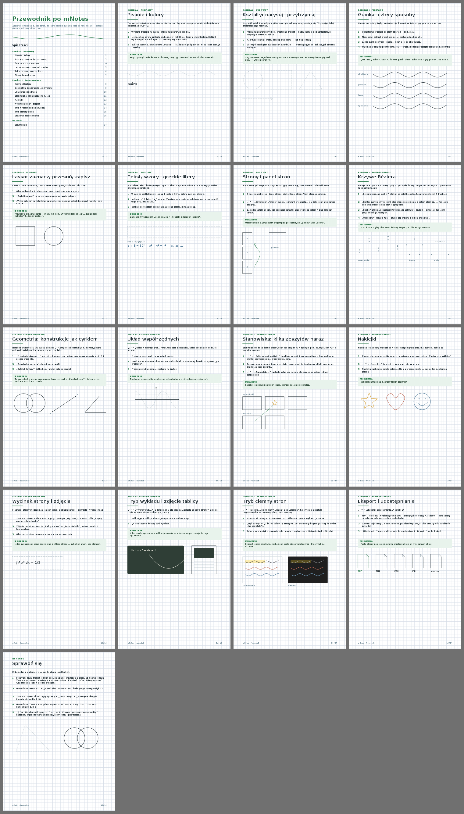

# mNotes

> Szkic (3a-2). Ostateczną wersję, licencję i informację o autorze zatwierdza autor projektu przed publikacją.

Zeszyt do pisania rysikiem na tablecie z Androidem, do nauki i na zajęcia. Działa w pełni offline: bez internetu, bez
kont i bez telemetrii. Aplikacja nie ma nawet uprawnienia `INTERNET`.



## Co potrafi

- **Zeszyty i foldery.** Pióra, zakreślacz, gumka, lasso, kształty i tekst. Strony w linie, w kratkę i w kropki.
- **PDF-y.** Import slajdów z zajęć i pisanie po nich. Eksport do PDF i PNG.
- **Geometria.** Cyrkiel, kątomierz, linijka i konstrukcje: okrąg przez 3 punkty, przecięcia, dwusieczna.
- **Krzywe.** Krzywe Béziera rysowane piórkiem i edycja ich węzłów.
- **Nauka.** Taśmy zakrywające odpowiedzi (odsłaniane dotknięciem), tryb wykładu i zeszyt-przewodnik z ćwiczeniami.
- **Stanowisko.** Kilka zeszytów i PDF-ów obok siebie na jednym płótnie.
- **Wyszukiwanie.** Szuka w tytułach, tekstach, tagach stron i w ustawieniach (rozumie też synonimy).
- **Tryb ciemny.** Obejmuje interfejs i, jeśli chcesz, papier.
- **Łącze z telefonem** (wariant `gms`). Zdjęcie zrobione telefonem od razu trafia na stronę na tablecie. Przez
  łącze przesyłasz też całe zeszyty. Działa bez internetu, a każda ramka jest szyfrowana kluczem pary.

Więcej podglądów w `docs/podglad/`, a specyfikacje funkcji w `docs/features/`.

## Warianty

| Wariant | Co zawiera |
|---|---|
| `foss` | Tylko wolne biblioteki (AndroidX, Compose, Kotlin). |
| `gms` | Dokłada łącze z telefonem przez Nearby z Usług Google Play. Łącze jest wyłączone, dopóki nie włączysz go w ustawieniach. |

Oba warianty mają ten sam identyfikator `com.mdev.mnotes` i ten sam format zeszytów.

## Budowanie

Potrzebujesz JDK 21 i Android SDK z platformą 36.1. Gradle przychodzi z wrapperem. Zanim zaczniesz, utwórz plik
`local.properties` z wpisem `sdk.dir=…`.

```sh
./gradlew :app:testFossDebugUnitTest :app:testGmsDebugUnitTest   # testy na JVM, bez urządzenia
./gradlew :app:assembleFossDebug                                  # APK w app/build/outputs/apk/foss/debug/
```

Logika (geometria, kodeki, układ, wyszukiwanie, łącze) leży w `app/src/main/java/com/mdev/mnotes/core/` i ma testy
jednostkowe. Zasady pracy nad kodem są w `CONTRIBUTING.md`.

## Licencja

Licencja jeszcze nie została wybrana, zob. `LICENSE-DO-DECYZJI.md`. Zależności i podziękowania są w `NOTICE.md`.

## English

mNotes is an offline handwriting notebook for Android tablets with a stylus. It has notebooks, PDF annotation,
geometry tools, study tapes and an optional phone-to-tablet photo link (`gms` flavor). The app, comments and docs are
in Polish, while the code itself is in English. To build it, run `./gradlew :app:assembleFossDebug` (JDK 21,
Android SDK 36.1). The license is still to be decided.
